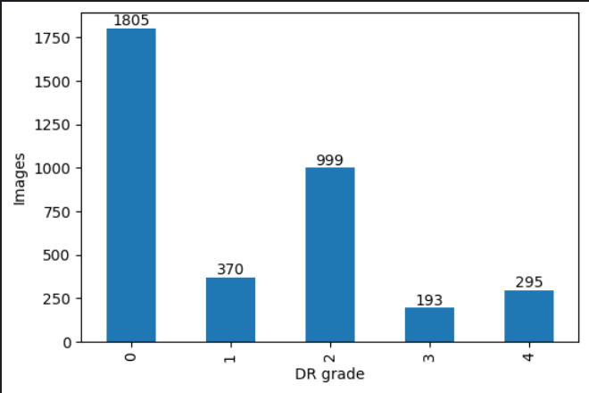
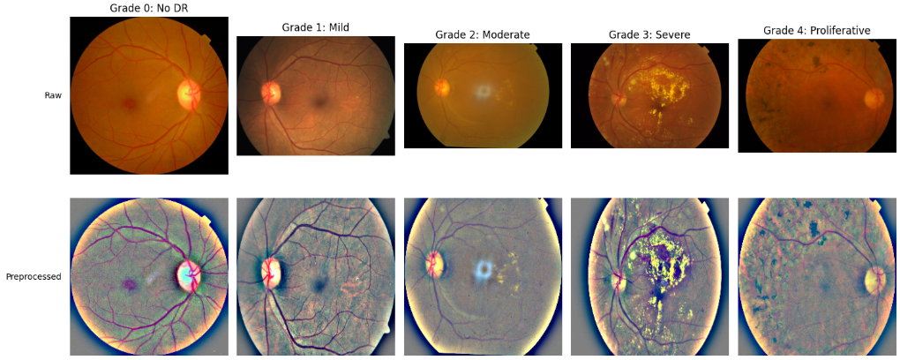
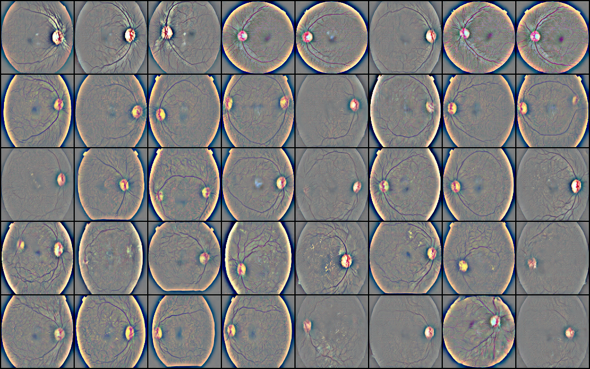

# GAN-Based Generation and Explainability of Synthetic Retinal Images for Disease Classification

A pipeline that trains a class-conditional GAN to generate synthetic retinal fundus images, tests whether they improve diabetic retinopathy (DR) grading for under-represented classes, and (planned) uses explainability methods to check what the classifier and generator rely on.

## Overview

Diabetic retinopathy grading is a 5-class problem (0 = No DR, 1 = Mild, 2 = Moderate, 3 = Severe, 4 = Proliferative). Medical datasets are small and heavily imbalanced, and the clinically most important grades are the rarest.

This project uses the **APTOS 2019 Blindness Detection** dataset (3,662 labelled fundus images) and asks three questions:

1. Can a lightweight conditional GAN produce plausible fundus images for the rare grades (1, 3, 4)?
2. Does adding those synthetic images to the training set improve a real-data baseline classifier?
3. (Planned) Do the classifier and generator attend to clinically meaningful features?

Synthetic data is **only ever added to the training split**. Validation and test sets are 100% real.

## Features

- EDA of class balance, image resolution and brightness, with per-grade image grids
- Preprocessing: black-border cropping, resizing and Ben Graham illumination normalization
- Near-duplicate detection (perceptual hashing) and a group-aware, stratified 70/15/15 split, to avoid leakage (APTOS has no patient IDs)
- Baseline classifier: EfficientNet-B0 (ImageNet-pretrained) with class-weighted loss, evaluated with QWK, AUC and per-class sensitivity/specificity
- Lightweight class-conditional GAN (conditional BatchNorm generator, spectral-norm projection discriminator, hinge loss, DiffAugment, EMA generator)
- Augmentation experiment: real-only vs. real + synthetic data over 3 seeds

## Project Structure

Suggested layout (the code was developed as Kaggle notebooks; adapt paths to your setup):

```
project/
├── notebooks/
│   ├── 01_eda.ipynb                    # class distribution, sizes, brightness, sample grids
│   ├── 02_preprocess_and_split.ipynb   # preprocessing, duplicate groups, splits.csv
│   ├── 03_baseline_classifier.ipynb    # EfficientNet-B0 on real data
│   └── 04_gan_and_augmentation.ipynb   # GAN training, generation, real vs real+synthetic
├── images/                             # figures used in this README
│   ├── class_distribution.png
│   ├── split_distribution.png
│   ├── gan_samples.png
│   └── real_vs_synthetic.png
├── requirements.txt
└── README.md
```

Files produced by the pipeline (not committed; large): `processed_raw/`, `processed_bg/`, `splits.csv`, `gan_ckpt.pt`, `synthetic/`, `synthetic.csv`, `augmentation_results.csv`.

## Installation

```bash
git clone https://github.com/your-username/your-repo.git
cd your-repo
pip install -r requirements.txt
```

Main dependencies: `torch`, `torchvision`, `opencv-python`, `numpy`, `pandas`, `scikit-learn`, `scipy`, `matplotlib`, `pillow`, `tqdm`. A GPU is required for GAN training and classifier fine-tuning (a Kaggle T4 is sufficient).

Download the data from [Kaggle: APTOS 2019 Blindness Detection](https://www.kaggle.com/c/aptos2019-blindness-detection) and place `train.csv` and `train_images/` in your data folder.

## Usage

Run the notebooks in order:

1. **EDA** - class distribution, resolution and brightness plots, one raw example per grade.
2. **Preprocess and split** - writes `processed_raw/` (crop + resize, used for the GAN) and `processed_bg/` (crop + resize + Ben Graham, used for the classifier), groups near-duplicates, drops groups with conflicting labels, and writes `splits.csv`.
3. **Baseline** - trains EfficientNet-B0 on real training images only and evaluates once on the test split.
4. **GAN and augmentation** - trains the conditional GAN on the train split, generates synthetic images for grades 1, 3 and 4 (up to about 600 train images per grade), and compares real-only against real + synthetic classifiers over 3 seeds.

Fix the random seed (`42` for the split) and reuse the same `splits.csv` for every experiment.
## Original data distribution and preprocessing results 

The code takes a raw fundus photo and turns it into a clean, fixed-size, lighting-normalized image. Applies **Ben Graham normalization** (the Kaggle DR competition winner's trick) used to standardize lighting and boost local contrast/texture.

### Class distribution


### Image preprocessing results



## Results

### Baseline (real data only, 256x256)

| Accuracy | QWK | Macro AUC |
|---|---|---|
| 0.802 | 0.870 | 0.933 |

Per-grade test sensitivity: 0.988 / 0.755 / 0.627 / 0.448 / 0.579 for grades 0-4. Severe (3) and proliferative (4) are the weak spots, which motivates augmentation.

### Augmentation experiment (128x128, mean ± std over 3 seeds)

| Metric | Real only | Real + synthetic | Difference |
|---|---|---|---|
| Accuracy | 0.777 ± 0.003 | 0.795 ± 0.011 | +0.018 |
| QWK | 0.869 ± 0.011 | 0.856 ± 0.004 | -0.013 |
| Macro AUC | 0.912 ± 0.002 | 0.925 ± 0.007 | +0.013 |
| Sensitivity, grade 0 | 0.979 | 0.980 | +0.001 |
| Sensitivity, grade 1 | 0.704 ± 0.066 | 0.591 ± 0.095 | -0.113 |
| Sensitivity, grade 2 | 0.599 ± 0.032 | 0.754 ± 0.051 | +0.155 |
| Sensitivity, grade 3 | 0.517 ± 0.034 | 0.345 ± 0.069 | -0.172 |
| Sensitivity, grade 4 | 0.421 ± 0.046 | 0.368 ± 0.070 | -0.053 |

### Image augmentation results

This figure presents the image augmentation results 



(The 128x128 real-only row is the fair comparison for the augmented run; it differs from the 256x256 baseline above.)

**Interpretation.** In this configuration, synthetic augmentation did **not** improve the augmented grades: sensitivity for grades 1, 3 and 4 decreased, and QWK did not improve. The rise in overall accuracy comes mostly from grade 2 (not augmented) being predicted more often, so it should not be read as a success. The test set is small (about 29 grade-3 and 38 grade-4 images), so individual differences carry wide uncertainty.


### Limitations and likely causes

- The GAN, trained on about 2,500 images at 128x128, may reproduce the overall look of a fundus (disc, vessels) without grade-specific lesions, so synthetic labels may not be backed by visible evidence.
- Class weights were computed on the combined real + synthetic set, so for grade 3 most of the weight sat on synthetic images, which diluted the real signal.
- Possible real/synthetic domain gap (artifacts the classifier can exploit but real test images lack).
- APTOS has label noise (about 28% of near-duplicate groups had conflicting grades), which limits achievable performance for every model.
- No patient IDs, so splits are image-level (with duplicate grouping), not patient-level.

### Planned next experiments

- [ ] Class weights from real counts only
- [ ] Dose ablation over the synthetic target (e.g. 300 / 400 / 600 / 900 images per grade)
- [ ] Confidence filtering of synthetic images using the real-only classifier
- [ ] Image-quality evaluation: FID/KID, precision/recall, nearest-neighbour memorization check, real-vs-fake detectability
- [ ] Stronger generator (e.g. conditional StyleGAN2-ADA)
- [ ] Explainability: Grad-CAM / Integrated Gradients on real vs. synthetic images, latent-space traversal, lesion-overlap analysis against IDRiD annotations
- [ ] Bootstrap confidence intervals on test metrics


## Ethics and Disclaimer

This is a research project, not a clinical tool. Synthetic images are not clinical validation, results depend on the dataset's devices and population, and the model must not be used for diagnosis.

## License

This project is licensed under the MIT License. The APTOS 2019 dataset is subject to its own terms on Kaggle.
